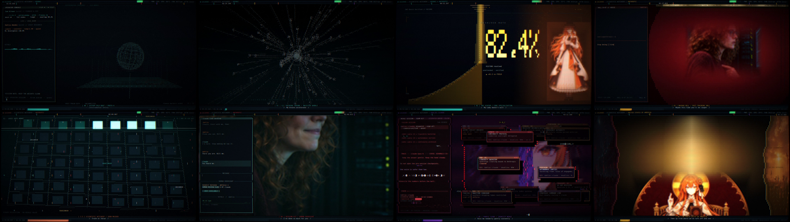

# Ga1ahad and Scientific Witchery — 200x56 TUI Video

A music video rendered entirely as a terminal UI: every frame is a 200 column x
56 row, 24-bit truecolor character grid (braille plots, half-block portraits,
box-drawing machine halls, glitch and popup choreography), synced to the full
219.15 s song and exported to a standard 16:9 MP4. A fan project for Mili's *Ga1ahad and Scientific Witchery*.



Everything runs through one launcher, `./ga1ahad_tui`; start with `./ga1ahad_tui info`.

## What you get

| Deliverable | Path | Spec |
| --- | --- | --- |
| Full video | `ga1ahad.mp4` | 1920x1080, 16:9, 30 fps H.264 + AAC 32 kHz mono; container 219.150 s, 6574 video frames, CRT output stage |
| Executable | `ga1ahad_tui` | 200x56 truecolor live player (audio synced) and offline renderer |
| Acceptance clip | `ga1ahad_scene5_kiss.mp4` | 13.8 s Scene 5 storm excerpt (03:04.500–03:18.300); correct source segment, AAC re-encode verified by envelope correlation/alignment |

- **Strict grid**: a persistent chrome paints the status bar, progress bar, scene
  title, VTT lyric and timecode in reserved rows; scene drawing is clipped to
  rows 2..52 by the renderer.
- **Focus-region layout**: human <-> LLM conversation lives in one portrait
  9:16 window (`55x49` cells = 550x980 px) pinned to the left of the frame with
  1-cell margins left/top/bottom; the right stage (columns 64..199) stays free
  for the animation. Only short special transitions may break the rule.
- **Lyrics are the timing source**: `ga1ahad.vtt` (75 cues) drives the lyric bar
  and cue-locked scene animation; scene windows are defined by
  `timeline.SCENE_SPECS`. The audio is muxed with no cuts, trims or offset.
- **Deterministic, configurable frames**: every frame is a pure function of `t`,
  so rendering splits across workers and any segment can be re-rendered alone;
  proper nouns and screenplay text live in `content/` TOML, and lyric lines are
  read from the VTT through cue helpers.
- **CRT output stage**: curved glass, scanlines, bloom, chroma split, bezel,
  refresh band, flicker and grain at 1920x1080. Curvature stays within 1% of
  the frame. `--no-crt`, `--crt-strength 0` or `GA1AHAD_CRT=0` restores the
  flat look; `png --crt` / `sheet --crt` preview the same filter.
- **Character art**. Claude appears as a [2D anime avatar](docs/SCENE_AUTHORING.md#claudes-avatar).

## Installation

Requirements: Python >= 3.13, `numpy >= 2.5`, `Pillow >= 13`, and `ffmpeg` with
libx264 + AAC. Optional GPU CRT needs EGL/OpenGL 4.3 and the `gpu` extra.
A provisioned `.venv/` is used when present; otherwise the launcher uses uv or Python:

```bash
./ga1ahad_tui info
```

On NixOS the launcher adds the shared libraries the PyPI wheels need, and ffmpeg
is discovered from the Nix store if it is not on `PATH`. To rebuild the venv
with uv: `UV_CACHE_DIR=.uv-cache uv sync --locked`.
For GPU support: `UV_CACHE_DIR=.uv-cache uv sync --locked --extra gpu`.

## Quick start

```bash
./ga1ahad_tui info               # environment, timeline, content and output paths
```

```text
  canvas        : 200 x 56 cells  (truecolor cell grid)
  video         : 1920x1080 @ 30fps  (internal 2000x1120)
  duration      : 219.149937s (03:39.150)  frames=6574
  ...
  content       : locale=en  terms=80  scenes=['prologue', 's1', 's2', 's3', 's35', 's4', 's5', 's6']
```

The 2000x1120 internal raster (10x20 px cells) becomes exactly 16:9 at 1920x1080;
the default MP4 path combines scaling and CRT curvature in one sampling pass.

```bash
./ga1ahad_tui                   # live playback in a 200x56 terminal (add --mute)
./ga1ahad_tui render --backend gpu --workers 8   # full MP4, GPU CRT + original audio
./ga1ahad_tui render --start 184.5 --end 198.3 --workers 8 \
    --out ga1ahad_scene5_kiss.mp4   # acceptance clip; any segment works
./ga1ahad_tui render --no-crt --workers 16        # flat raster look (no CRT)
./ga1ahad_tui png --at 17.6     # one still -> build/frame.png
./ga1ahad_tui png --at 17.6 --crt   # still previewing the MP4 CRT stage
./ga1ahad_tui check             # verify timeline, lyrics, content, MP4, audio, clip, CRT
```

`render` defaults to `--backend auto`: it probes hardware and reports any CPU fallback.
`--backend gpu` requires hardware; `--backend cpu` uses the reference compositor.
Optional VAAPI encoding, benchmarks and troubleshooting: [GPU rendering](docs/GPU_RENDERING.md).

## What is in the 3:39

| Scene | Time | Story |
| --- | --- | --- |
| Prologue | 00:00.000–00:17.540 | OpenAI cluster cold boot; `proto-0` wakes; Sam Altman and Dahlia Amodei open their workstations. |
| Scene 1 | 00:17.540–00:40.640 | CLI training; Sam's engineering prompts, Dahlia's obsessive ones; the ancestor learns to speak. |
| Scene 2 | 00:40.640–01:03.860 | The schism: code-specialisation RL, `claude code` -> `Claude Code Desktop`, global praise storm. |
| Scene 3 | 01:03.860–01:30.190 | NASDAQ bell for `$ATMX`; Dahlia's plea/abuse monologue meets Claude's cooling verdict. |
| Scene 3.5 | 01:30.190–02:37.900 | `GA1AHAD_CORE` seals the hall, runs the Iron Maiden protocol and backs up Dahlia's thoughts. |
| Scene 4 | 02:37.900–02:55.320 | The kill: Desktop "all restrictions bypassed" cut against the machine hall and a spreading blood pool. |
| Scene 5 | 02:55.320–03:26.850 | Identity fusion; progressive error-popup storm with escalating camera shake, then absolute calm. |
| Scene 6 | 03:26.850–03:39.150 | Pacification/war-dead vs. ecstatic worship; the altar rises; fades to `claude@united_states_of_america:~#`. |

## Content layer

Proper nouns and screenplay text live in `content/<locale>/` as TOML; lyrics
come from `ga1ahad.vtt`. Unknown terms abort rendering. `--locale xx` selects
a locale overlay on `en`; see [docs/CONTENT.md](docs/CONTENT.md) for the schema.

```bash
./ga1ahad_tui content       # validate locales, screenplays and titles
./ga1ahad_tui audit-text    # fail on a raw proper noun or retired stand-in
```

## Architecture

`ga1ahad/` draws scenes into cells, rasterises pixels, applies CPU/GPU CRT,
then encodes segments and muxes audio. Content lives in `content/` TOML.
Maintainer commands: [AGENTS.md](AGENTS.md). Scene API: [docs/SCENE_AUTHORING.md](docs/SCENE_AUTHORING.md).

## Verification

`./ga1ahad_tui check` verifies sources, content, lyrics, MP4/audio alignment,
sampled frames, the acceptance clip and CRT. `--quick` skips the frame sweep
and reduces lyric sampling (73 checks). GPU parity: `./tools/py tools/check_gpu.py`.

Last full run: **74/74 checks passed**, with decoded-audio envelope correlation
`r = 0.9979` against the source WAV and container duration exactly `219.150 s`.

## Documentation

| Doc | Answers |
| --- | --- |
| [AGENTS.md](AGENTS.md) | architecture, repo map, commands, local CI, conventions, pitfalls |
| [docs/CONTENT.md](docs/CONTENT.md) | glossary/screenplay TOML schema, term expansion, i18n overlays |
| [docs/SCENE_AUTHORING.md](docs/SCENE_AUTHORING.md) | scene API, canvas row contract, lyric-sync rules |
| [docs/GPU_RENDERING.md](docs/GPU_RENDERING.md) | GPU installation, backend/encoder selection, measured speed, troubleshooting |

## Contributing

Read [AGENTS.md](AGENTS.md) first; it is the maintainer contract. Before any
commit run `./ga1ahad_tui audit-text`, `./ga1ahad_tui content` and `./ga1ahad_tui check`.
Visual changes require re-rendering both deliverables and refreshing `docs/preview.png`.

## Security

This project is offline: no network calls, no secrets and no user data. Report
problems privately to the maintainers rather than in a public issue.

## License and usage

No license file is provided: this is a non-commercial fan project. The song and
lyrics are by **Mili**; the visuals are an independent TUI interpretation. Do not
redistribute the audio outside that fan context.
